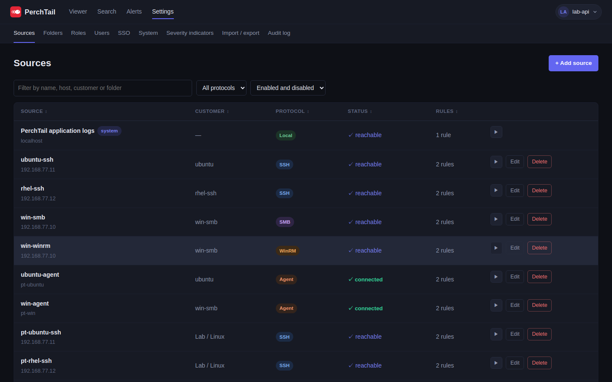
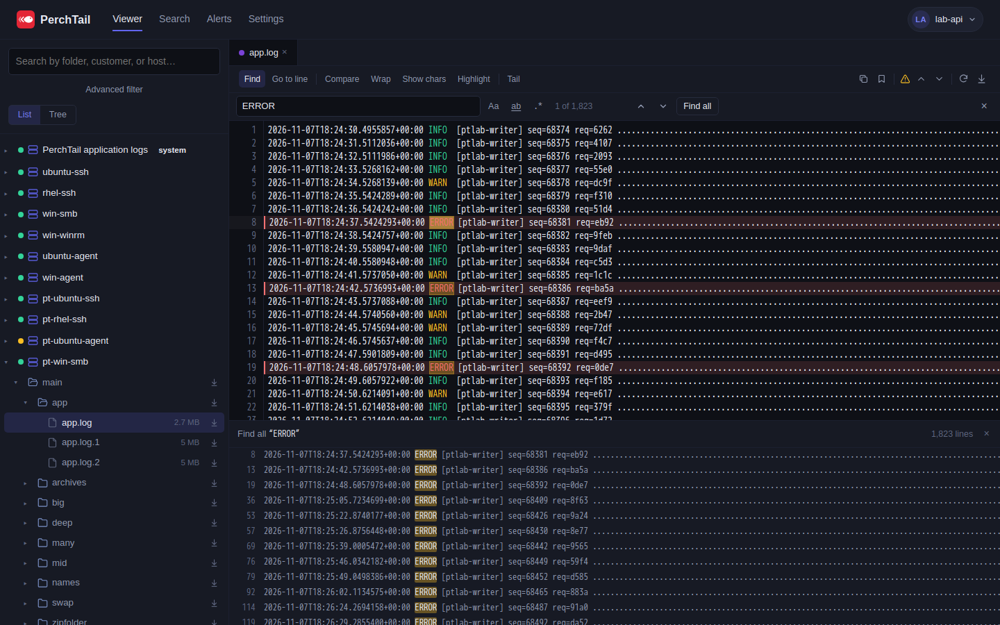
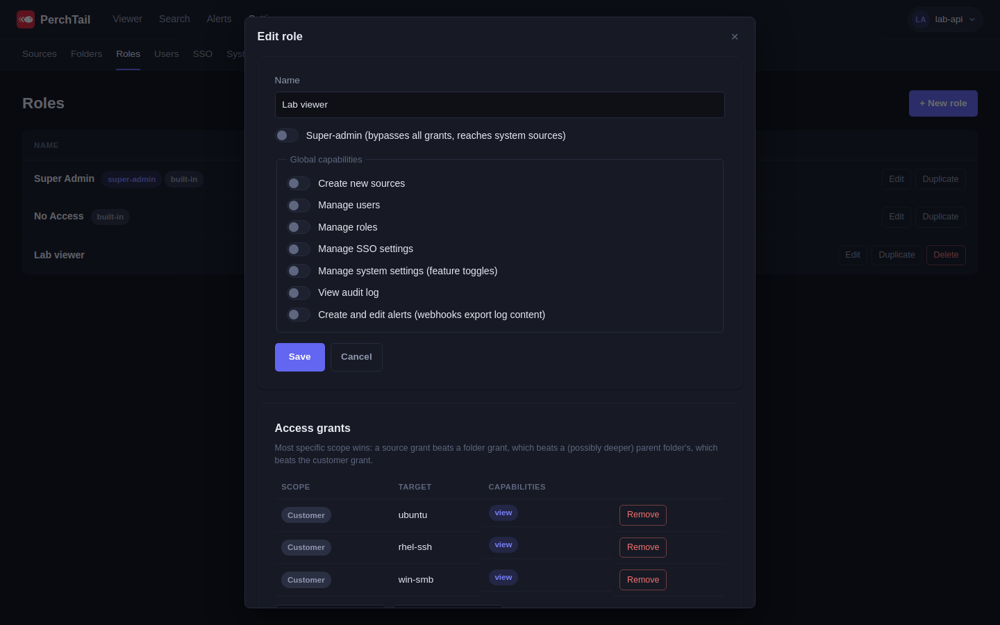

<p align="center">
  
</p>

<h1 align="center">PerchTail</h1>

> Live, rule-scoped log browsing across Linux and Windows servers — agentless by default, nothing mirrored, nothing left behind.

[](LICENSE)
[](#status)
[](https://github.com/quaresma870/perchtail/actions/workflows/ci.yml)

**Contents:** [Status](#status) · [What it is](#what-it-is) ·
[Why not just use X](#why-not-just-use-x) ·
[Feature comparison](#feature-comparison) · [Screenshots](#screenshots) ·
[Quick start](#quick-start) ·
[Deployment: reverse proxy + TLS](#deployment-reverse-proxy-nginx--tls) ·
[Documentation](#documentation) · [License](#license)

## Status

🟢 **v0.6.3** is the current release: usable today, still pre-1.0.

- **Sources:** SSH/SFTP, SMB and WinRM without installing anything on the server (WinRM also through a read-only JEA endpoint that needs no administrator account), and a Go push agent for hosts that can't be reached inbound. A source can read several folders. Every open is a fresh fetch; nothing is mirrored.
- **Viewer:** one explorer across every source, as a list or a tree, with each file's size, a status dot per source, folders that refresh themselves and an advanced filter across sources and folders. A CodeMirror editor with tabs from several servers, Tail that fetches only the new lines, one find bar with Find all over files of any size, compare, beautify, highlights and bookmarks.
- **Access:** roles scoped by customer, folder and source; local accounts with a password policy (NIST defaults) and optional TOTP; OIDC single sign-on with group-to-role mapping.
- **Operations:** settings in popups, an update check, a detailed health endpoint, an audit log that is hash-chained and verified, bulk YAML import and export.
- **Security work so far:** login lockout, CSP and security headers, credential encryption with key rotation, SSH host-key pinning, session revocation, a DNS-rebind-safe webhook fetcher, CodeQL, gosec, Bandit, zizmor, fuzz and property tests in CI.

**What's next.** 0.7 is the last feature release before 1.0. It removes the content index and the full-text Search page, so nothing from the logs is stored, and adds a file-name index with one search across sources, folders and files, live alerts, PostgreSQL support, push-agent upgrades from the portal, user groups and temporary access, notifications and API tokens. 1.0 adds no features: load tests and a sizing guide, OWASP ZAP, OpenSSF Scorecard and provenance in CI, and an external pentest. See [ROADMAP.md](ROADMAP.md) and [CHANGELOG.md](CHANGELOG.md).

Tested with `pytest` (backend), `vitest` (frontend units) and a Playwright suite that drives the real UI against real SSH and SMB servers, and every release candidate is retested in a lab with Linux, Windows and push-agent sources before the release. SAML isn't built (OIDC covers Entra ID, Okta, Google Workspace and Keycloak), and PerchTail hasn't seen production traffic beyond the maintainer's own use.

## What it is

PerchTail gives support and ops engineers one place to browse, open, and download
log files live from a mix of Linux and Windows servers — without installing
anything on those servers, and without permanently copying their content anywhere.

You configure **sources** (a host and how to reach it — SSH/SFTP, SMB, WinRM, or a push agent), attach **rules** (which files and folders are visible, glob or regex, evaluated in order), and PerchTail lists and fetches matching files live, opened in a Notepad++/VS-Code-style viewer and downloadable as single files or zipped folders. A `.zip` or `.tar.gz` archive opens as a folder whose files go through the same rules; an archive with a file whose last matching rule is an exclude can't be downloaded whole (its other files still open and download one by one), and a folder's ZIP leaves it out and lists it in `SKIPPED.txt`. Nothing is proactively mirrored or cached across views — every open is a fresh fetch, because the logs behind it are still being written.

RBAC is built in from day one: access is scoped per customer/environment, not just
per user, so a support engineer working one account can't accidentally browse
another's production logs.

## Why not just use X

- **Graylog / OpenSearch / Wazuh** — built around search over an ingested,
  indexed copy of your data. Great if you want that; overkill if you just want to
  look at what's actually on the box right now, and archiving-to-disk is often
  gated behind enterprise tiers.
- **rclone / rsync** — excellent at rule-based selective access to remote files,
  but no viewer, and built to copy rather than to browse-and-discard.
- **Filebrowser / Filestash / code-server** — good viewers, but no rule-scoped,
  cross-protocol, multi-source access with RBAC on top.

PerchTail is the missing middle: rule-scoped live access plus a real viewer, with
nothing sitting around afterward for someone to leak or for disk to fill up with.

## Feature comparison

| | PerchTail | Graylog | Wazuh | rclone + a file browser | Loki |
|---|---|---|---|---|---|
| Live view, nothing stored | ✅ | ❌ ingests a copy | ❌ ingests a copy | ❌ mirrors to disk | ❌ ingests a copy |
| Agentless Linux + Windows | ✅ SSH/SFTP, SMB, WinRM | needs Beats/NXLog agents | needs an agent | rclone remotes | needs Promtail agent |
| Customer/environment-scoped RBAC | ✅ built in | limited / enterprise | role-based, not scoped this way | ❌ | limited |
| SSO | ✅ OIDC (SAML 🚧 if needed) | enterprise tier | ✅ | ❌ | via Grafana |
| Code-editor-style viewer | ✅ CodeMirror | search UI, not a file viewer | search UI | depends which browser | Grafana Explore |
| Setup | single docker-compose | multi-service | multi-service | multiple tools glued together | multi-service |

This table reflects the design as of this writing and each project evolves —
verify anything that matters to your decision against current docs.

## Screenshots

Sources, with their customer, protocol and status, and the actions on each row:



The viewer: the explorer with file sizes and a status dot per source, a log open with error lines tinted, the find bar ("1 of 1,823") and Find all listing every matching line below:



A role in its editor, opened over the roles list: global capabilities and access grants, the most specific scope winning, from customer down to a single source:



The `create_source` global capability adds sources; changing, moving or deleting an existing one also needs manage rules on it (and, to move it, where it goes). Short of super admin, someone with `manage_users` or `manage_roles` can't change their own role or edit the role they hold, and can only hand out roles and grants within their own: no global capability they lack, and no capability in a customer, folder or source that they don't hold there themselves.

## Quick start

```bash
git clone https://github.com/quaresma870/perchtail.git
cd perchtail
cp .env.example .env
```

Edit `.env` and set a real `CREDENTIAL_ENCRYPTION_KEY` — this encrypts SSH/SMB/
WinRM credentials at rest, so don't ship the placeholder:

```bash
python3 -c "import secrets; print(secrets.token_urlsafe(32))"
```

This walkthrough browses PerchTail over plain `http://localhost:8080` to get
you looking at the UI quickly — for that to work, also set
`SESSION_COOKIE_SECURE=false` in `.env` first. Leave it at its default
(`true`) for any real deployment: browsers silently drop a `Secure` session
cookie over plain HTTP, so with the default left on, login would appear to
just bounce back to the login page with no error. See
[Deployment: reverse proxy + TLS](#deployment-reverse-proxy-nginx--tls)
below for how to run this for real, with `SESSION_COOKIE_SECURE` left at its
secure default.

Then bring it up:

```bash
docker compose up -d
```

This builds the image from the checkout. To run a published release
instead, replace `build: .` in `docker-compose.yml` with the image of that
version (amd64 and arm64), for example:

```yaml
    image: ghcr.io/quaresma870/perchtail:0.6.3
```

Each [GitHub release](https://github.com/quaresma870/perchtail/releases)
also carries the push-agent binaries, their `SHA256SUMS`, and the image's
SBOM, attached before the release is published. `latest` and `X.Y` tags
only move when a full release is published, never with a pre-release.

On first startup (only when the database has zero users), PerchTail creates a
break-glass super-admin account with a randomly generated password and prints
it once to the container logs — grab it before it scrolls away:

```bash
docker compose logs perchtail | grep initial_super_admin
```

Open `http://localhost:8080`, sign in with that username/password (`admin` by
default — override with `INITIAL_ADMIN_USERNAME` in `.env` before first
startup), and you'll be forced to set your own password immediately. From
there: **Settings → Sources → + Add source** to point PerchTail at a server
(see [docs/source-setup.md](docs/source-setup.md) for what the source side
needs configured first), attach a rule so something is actually visible (a
source with zero rules shows nothing, by design), and open **Viewer** to
browse it.

State (the SQLite database, rotated application logs, and the ephemeral
scratch cache) lives in the `perchtail-data` Docker volume, so it survives
`docker compose down`/`up` — only `docker compose down -v` discards it.

**Backups and upgrades.** Everything stateful lives on the `perchtail-data`
volume (`/data` in the container), one directory per kind of data:

| Directory | Setting | Contents | Back up? |
|---|---|---|---|
| `/data/db` | `DATA_DIR` | SQLite database, credential-encryption salt (`credential_salt`), SSH `known_hosts` | yes |
| `/data/logs` | `LOG_DIR` | the app's own logs, rotated by size and day | optional |
| `/data/scratch` | `SCRATCH_DIR` | short-lived fetches, purged on close | no |

Each can be mounted as its own volume (for example logs on another disk),
so a burst of DEBUG logging can't fill the database's disk. Keep `/data/db`
on a local disk, not a network share: the database runs in SQLite's WAL
mode, which needs one (it also leaves `perchtail.db-wal` and
`perchtail.db-shm` next to the database; back up the whole directory, with
PerchTail stopped). Back up the
database and `credential_salt` together. Either one is useless without the
other, and so is the salt without your `CREDENTIAL_ENCRYPTION_KEY`.
Upgrading from a release before 0.5.0 moves the database, salt and
`known_hosts` from `/data` into `/data/db` on first start; see the
CHANGELOG's upgrade notes.

**Update check.** Once a day, PerchTail asks the GitHub releases API which
release is the latest (one unauthenticated request; nothing about your
installation is sent, and pre-releases are never offered). Super admins see
the result under **Settings → System → Updates**, with the upgrade steps for
how this instance was installed. Turn it off there, or set
`UPDATE_CHECK=false` to make sure PerchTail never makes that request (for
example on a network without internet access). `HTTPS_PROXY` is honoured.
The source overview also shows each push agent's version, and flags agents
older than the server.

## Deployment: reverse proxy (nginx) + TLS

**Never expose PerchTail's admin/viewer UI to the public internet without
TLS termination and something in front of it** — it's the entry point to
every source's credentials and every source's log content across every
customer configured, gated only by the session cookie. `docker-compose.yml`
publishes the app directly on `8080` for the [Quick start](#quick-start)
above; for anything beyond your own machine, put a reverse proxy in front
of it and stop publishing that port to anything but `localhost`.

1. Bind the published port to loopback only, so it's reachable through
   nginx but not directly from outside the host — edit `docker-compose.yml`:

   ```diff
   -      - "8080:8000"
   +      - "127.0.0.1:8080:8000"
   ```

2. Set `PUBLIC_BASE_URL` in `.env` to the real external `https://` URL
   you're about to configure below (used to build the OIDC `redirect_uri`
   if you set up [SSO](docs/sso-setup.md), and by the agent protocol's
   `wss://` endpoint if you use [push-agent sources](docs/source-setup.md#agent-push-agent-for-hosts-not-reachable-inbound)).
   Leave `SESSION_COOKIE_SECURE` at its default (`true`) — nginx is about
   to terminate real TLS, so the browser will actually have an `https://`
   origin to set that cookie on.

3. An nginx server block terminating TLS and proxying everything to the
   app:

   ```nginx
   server {
       listen 80;
       server_name perchtail.example.com;
       return 301 https://$host$request_uri;
   }

   server {
       listen 443 ssl http2;
       server_name perchtail.example.com;

       ssl_certificate     /etc/letsencrypt/live/perchtail.example.com/fullchain.pem;
       ssl_certificate_key /etc/letsencrypt/live/perchtail.example.com/privkey.pem;

       location / {
           proxy_pass http://127.0.0.1:8080;
           proxy_set_header Host $host;
           proxy_set_header X-Forwarded-For $proxy_add_x_forwarded_for;
           proxy_set_header X-Forwarded-Proto $scheme;

           # Needed for the agent protocol's persistent WebSocket connections
           # (wss://.../agent/connect) -- harmless no-ops for ordinary HTTP
           # requests, which never carry an Upgrade header in the first
           # place. Without proxy_read_timeout raised, nginx's 60s default
           # would silently drop an agent's otherwise-idle connection every
           # minute (it reconnects on its own, but there's no reason to make
           # it); skip this whole block if you don't use the Agent protocol.
           proxy_http_version 1.1;
           proxy_set_header Upgrade $http_upgrade;
           proxy_set_header Connection "upgrade";
           proxy_read_timeout 3600s;
       }
   }
   ```

   PerchTail doesn't need `X-Forwarded-Proto` trusted to behave correctly —
   its CSRF Origin-check only ever compares `Host`, deliberately never
   scheme, precisely so it works the same whether or not a proxy sits in
   front (see ROADMAP.md's CSRF-review notes if you're curious why). It's
   sent above anyway since it's a generally useful signal for nginx's own
   access logs.

4. `docker compose up -d` to pick up the port-binding change, then reload
   nginx. Sign in at `https://perchtail.example.com` — the break-glass
   account created on first startup still works exactly as in the Quick
   start above.

Running nginx in its own container instead of on the host works the same
way — attach it to a shared Docker network with the `perchtail` service and
`proxy_pass` to `http://perchtail:8000` directly, and drop the host port
publish in `docker-compose.yml` entirely rather than binding it to loopback.

## Documentation

- [CLAUDE.md](CLAUDE.md) — full design/architecture reference and build plan
- [ROADMAP.md](ROADMAP.md) — phased milestones and what's next
- [docs/install-from-source.md](docs/install-from-source.md) — running
  PerchTail on a Linux host without Docker, with a systemd unit
- [docs/source-setup.md](docs/source-setup.md) — how to prepare a Linux or
  Windows server so PerchTail can reach it over SSH/SFTP, SMB, or WinRM
- [docs/examples/jea](docs/examples/jea/README.md) — the read-only JEA endpoint for WinRM sources without a remote shell or administrator account
- [docs/sso-setup.md](docs/sso-setup.md) — registering PerchTail as an OIDC
  client and setting up group-to-role mapping, with per-provider notes for
  Azure AD/Entra ID, Okta, Google Workspace, and Keycloak/Authentik
- [docs/monitoring.md](docs/monitoring.md) — the detailed health endpoint for
  external monitoring (Zabbix, Prometheus), and how to generate its token
- [docs/credential-key-rotation.md](docs/credential-key-rotation.md) — how to
  rotate `CREDENTIAL_ENCRYPTION_KEY` without losing access to already-
  encrypted credentials
- [docs/high-availability.md](docs/high-availability.md) — whether/how to run
  PerchTail behind a load balancer or in a multi-replica k3s/Kubernetes
  deployment, broken down by solution and load-balancing type
- [CONTRIBUTING.md](CONTRIBUTING.md) — how to get a dev environment running and
  submit changes
- [SECURITY.md](SECURITY.md) — how to report a vulnerability, and how fast fixes ship
- [CHANGELOG.md](CHANGELOG.md) — what's shipped, release by release

## License

MIT — see [LICENSE](LICENSE).
